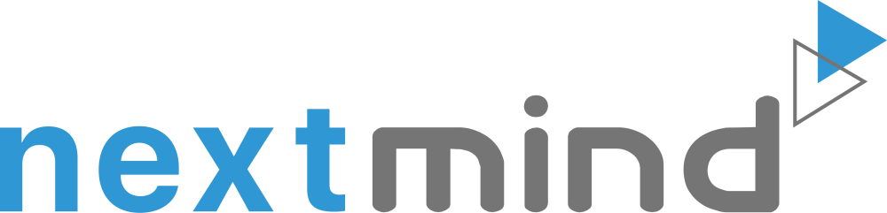
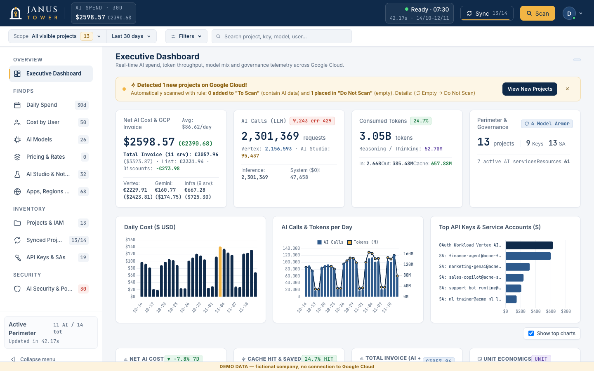
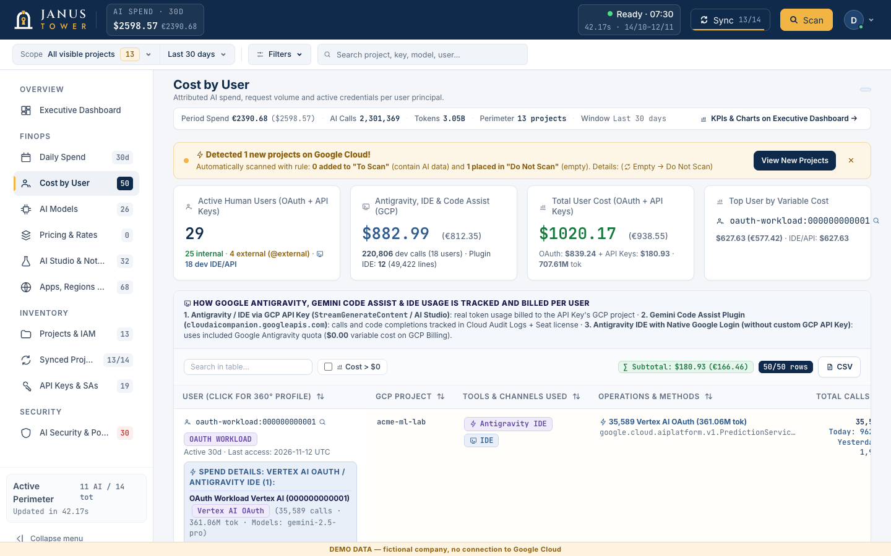
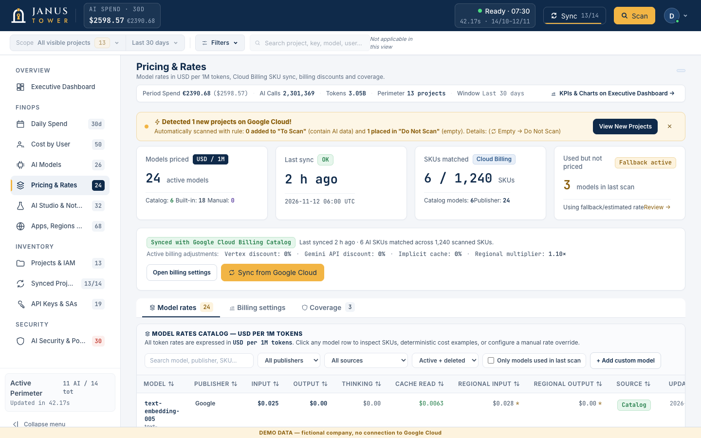
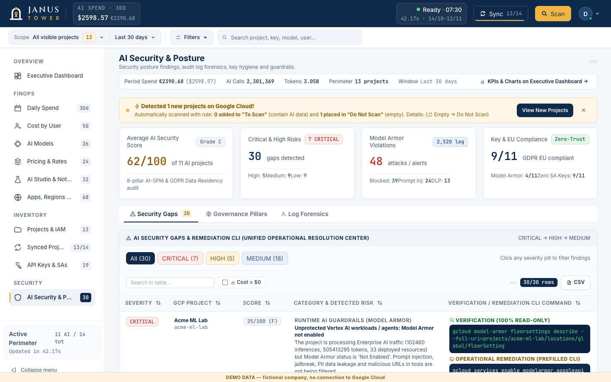

<div align="center">


### AI FinOps & Security Posture Control Tower for Google Cloud
*Look both ways across your Cloud AI estate: token economics on one face, Shadow AI and security posture on the other.*

[](https://github.com/Nextmind-srl/janus-tower/actions/workflows/ci.yml)
[](./LICENSE)
[](https://www.python.org/)
[-10B981.svg)](./requirements.txt)
[](./Dockerfile)

<br>

<a href="https://nextmind.it/">
  <picture>
    <source media="(prefers-color-scheme: dark)" srcset="docs/images/nextmind-logo-on-dark.png">
    
  </picture>
</a>

Created by **[Nextmind S.R.L.](https://nextmind.it/)**<br>
Authors: Marco Mancini ([m.mancini@nextmind.it](mailto:m.mancini@nextmind.it)) and Mattia Guzzi ([m.guzzi@nextmind.it](mailto:m.guzzi@nextmind.it))

</div>

---

**In Rome, every door had a god.** Janus watched the threshold with two faces: one looking in, one looking out. Nothing started without passing him, which is why January still carries his name.

Your cloud has a lot of doors too. Every API key and service account is one, and behind it sits Gemini. Somebody has to watch both directions: **who walks through and what it costs**, and **who walks through that shouldn't**.

JanusTower is the watchtower. It looks, it counts, it never touches the lock: **local and read-only**.

---

JanusTower is a **local, read-only** web app that scans the Google Cloud projects you can access and answers two questions in one dashboard: **who is spending on AI (which project, model, credential, person), and how exposed is that AI usage** (old or unrestricted keys, risky service accounts, Shadow AI through personal credentials, unguarded agents, inference outside the EU).

It is built for FinOps, platform and security teams that run Gemini / Vertex AI on Google Cloud and want a first answer without setting up a data pipeline. It runs on your machine, never writes to Google Cloud, and its costs are **estimates** (see [Known limitations](#known-limitations)).

## Screenshots

All screenshots show the built-in **demo data** (a fictional company, "Acme Corp"): no real project, person or invoice.

**Executive Dashboard**



**FinOps › Cost by User**



**FinOps › Pricing & Rates**



**AI Security & Posture**



### Try it without Google

No Google account is needed to look around. When no OAuth client is configured, JanusTower starts in **demo mode** on its own: it shows the "Explore the demo" button on the login screen, uses invented data and a temporary data folder, and never contacts Google or touches your real `data/` folder. You can also force it with `JANUSTOWER_DEMO=1`, or switch it off with `JANUSTOWER_DEMO=0`. A "DEMO DATA" banner stays visible in every view while it is on. To use your own data, configure the OAuth client as described in the [Quickstart](#-quickstart).

To run the demo:

```bash
git clone https://github.com/Nextmind-srl/janus-tower.git
cd janus-tower
JANUSTOWER_DEMO=1 python server.py
```

Open **http://localhost:8095** and click **Explore the demo** on the login screen. You will see a fictional company ("Acme Corp") with 14 projects and every view filled in. Stop it with `Ctrl+C`: the temporary data folder is deleted on exit.

- **Another port:** `PORT=8097 JANUSTOWER_DEMO=1 python server.py`. In demo mode any port works, because no Google sign-in is involved.
- **Docker:** `docker compose up -d --build` also starts the demo when no OAuth client is configured.
- **Back to your own data:** set `JANUSTOWER_DEMO=0` (or configure the OAuth client) and restart.

## What it does

| Area | In short |
| :--- | :--- |
| **AI FinOps (estimated)** | Calls, tokens and estimated cost per project, model, day, credential and user, from Cloud Monitoring metrics and a rate catalog. Only AI costs are counted: Vertex AI, Gemini API and managed AI services (Gemini Enterprise / Agentspace, NotebookLM, Dialogflow CX, Code Assist, Model Armor). |
| **Pricing & Rates** | Model list and per-model rates read from Google APIs, daily read-only sync, manual overrides and billing adjustments. [Details](docs/pricing-and-rates.md) |
| **Cost calibration** | A helper proposes discount, cache-hit and FX values from a Cloud Billing CSV export. [Details](docs/cost-calibration.md) |
| **Key & identity attribution** | Links usage to API keys, service accounts, OAuth workloads and users (Cloud Audit Logs). [What cannot be attributed](docs/attribution-and-limits.md) |
| **Shadow AI** | Flags AI usage through personal credentials (ADC / OAuth), Workbench, Colab Enterprise, AI Studio keys, IDE Code Assist and NotebookLM. |
| **Agents & Gemini Enterprise** | Discovers Gemini Enterprise / Agentspace apps, data stores, connectors, Reasoning Engines, Dialogflow CX agents and Agent Registry entries; on-demand read-only probe of one app. |
| **AI security posture** | 0-100 score per project with findings and suggested `gcloud` remediation; Model Armor templates and floor settings. |
| **Data residency** | Calls, resources and cost split by region (`europe-*` vs. non-EU / `global`). |
| **Multi-account, multi-project** | Several Google accounts in one browser session, parallel project scans, per-account local cache, selective "synced projects" list. |
| **Local budgets** | Per-project budget thresholds saved locally; nothing is changed in Google Cloud. |

More detail: [Pricing & Rates](docs/pricing-and-rates.md), [Cost calibration](docs/cost-calibration.md), [Attribution and limits](docs/attribution-and-limits.md).

---

## 🔒 Security model & privacy

**JanusTower is a local, single-user tool.** It listens on `127.0.0.1` by default. Do not expose it on a network or share one instance between several people: it is not designed as a multi-tenant web service.

- **Read-only towards Google Cloud.** Scans only use `GET` calls and read-only query calls (`testIamPermissions`, `timeSeries`, `entries:list`, Cloud Billing `services/.../skus`, …). Budgets and pricing overrides are saved locally and never pushed to Google Cloud.
- **Daily login.** A Google login is valid until local midnight and only in the browser that performed it.
- **Host and Origin checks.** Requests are accepted only for `localhost`, `127.0.0.1`, `[::1]` and the hosts you list in `LOOPBACK_HOST`, `PUBLIC_BASE_URL` or `ALLOWED_HOSTS` (comma-separated); `POST` requests and `GET /api/scan` also refuse a foreign `Origin`. If you reach the app through a reverse proxy or another host name, add it to `ALLOWED_HOSTS`, otherwise you will get HTTP 403.
- **Content-Security-Policy.** The page is served with a CSP that lets the browser run only the app's own inline script (authorised by its SHA-256, no `'unsafe-inline'`) and the two pinned CDN libraries (Tailwind, Chart.js, both with SRI); `'unsafe-eval'` is not allowed, so injected scripts and `on*` handlers are refused even if a value were ever left unescaped. Styles still allow `'unsafe-inline'` (the Tailwind CDN injects `<style>` at runtime). If you add a new external resource, set `CSP_REPORT_ONLY=1` to see what the policy would block without breaking the page.
- **Local storage in `data/`** (ignored by Git and by the Docker build):
  - `oauth_tokens.json` — your Google OAuth tokens, **stored in plain text**. Protect this folder like a password.
  - `scan_cache_v9_<account>_<period>.json` and `projects_sync_registry.json` — scan results.
  - `models_pricing_config.json` — local model rate catalog, Cloud Billing sync metadata, billing adjustment rules, and manual rate overrides.
  - `budgets_config.json` — local budgets.

### Personal data

Scan results can contain **personal data** of people in your organization:

- user email addresses found in Cloud Audit Logs (per-user cost and Shadow AI views);
- Gemini Enterprise / Agentspace **user licenses** (user identities) and **session metadata** (pseudonymous user ids, number of turns, start/end times — not the conversation text).

Before running JanusTower on a company estate, check that this processing is covered by your internal privacy rules (GDPR). To remove it:

- **Delete local data** button (top bar, visible when signed in): deletes the scan cache files and the synced-project list **of the signed-in account only**. Your login and budgets are kept, other accounts are not touched. Note: reloading the page or changing the period afterwards starts a new scan automatically, which downloads the data again.
- Or stop the app and delete the files in `data/` (also works when your Google session has expired, which the button requires).

---

## ⚡ Quickstart

### 🤖 Let your AI coding agent install it

Using Claude Code, Codex, Gemini CLI, Cursor or a similar agent? Open an empty folder, paste this prompt and follow along:

```text
Install JanusTower (https://github.com/Nextmind-srl/janus-tower) on this machine.
1. Clone the repository and read README.md and AI_AGENT_CONTEXT.md first.
2. Check that Python 3.11+ is available, create a virtual environment and install requirements.txt.
3. Copy .env.example to .env and leave the OAuth values EMPTY.
4. Walk me through "Create your OAuth client" in the README. I will create the client in
   my own Google Cloud console and paste the ID and secret into .env MYSELF.
   Never ask me to paste secrets in this chat and never print the contents of .env.
5. Start the server with `python server.py` (default port 8095) and tell me to open
   http://localhost:8095 and sign in myself.
Do not run anything with sudo, do not touch any Google Cloud resource, and do not
commit .env. The app is read-only: keep it that way.
```

The agent can do everything except the two steps that must stay yours: creating the OAuth client and signing in. Prefer to do it by hand? Follow the steps below.

### 1. Prerequisites

- **Python 3.11+**
- A Google account with read access to the projects you want to inspect (see [permissions](#-required-cloud-permissions-read-only)).

```bash
git clone https://github.com/Nextmind-srl/janus-tower
cd janus-tower
python -m pip install -r requirements.txt
cp .env.example .env
```

### 2. Create your OAuth client

JanusTower does **not** ship any OAuth client: each installation uses its own.

1. In the Google Cloud console choose (or create) a project for the tool.
2. **APIs & Services → OAuth consent screen**: user type **Internal** (Google Workspace organizations), set the app name. Scopes used: `openid`, `.../auth/userinfo.email`, `.../auth/cloud-platform`.
3. **APIs & Services → Credentials → Create credentials → OAuth client ID**, application type **Desktop app**. Desktop clients accept the local redirect `http://localhost:<port>/oauth2callback` on any port.
4. Put the client ID and secret in your `.env` file (never commit it):

```bash
GCP_OAUTH_CLIENT_ID=<client id>
GCP_OAUTH_CLIENT_SECRET=<client secret>
```

Without these values the server still starts, but the login button returns an "OAuth client not configured" message.

### 3. Run

```bash
python server.py
```

Open **http://localhost:8095** and sign in with Google. If port 8095 is busy the server tries the next ports and prints the URL it uses.

---

## 🐳 Run with Docker

```bash
docker build -t janustower:latest .

docker run -d --name janustower \
  -p 127.0.0.1:8095:8095 \
  --env-file .env \
  -v "$(pwd)/data:/app/data" \
  janustower:latest
```

Then open **http://localhost:8095**. Publishing on `127.0.0.1` keeps the app reachable only from your machine. The published port must stay **8095**, because the OAuth redirect URI is built from it.

**With Docker Compose** (same settings plus a read-only root filesystem, no Linux capabilities and `no-new-privileges`):

```bash
cp .env.example .env   # fill in your own OAuth client
docker compose up -d --build
```

On **Linux**, the container runs as a non-root user: if it cannot write to `./data`, add `user: "${UID}:${GID}"` to the compose service (or `--user "$(id -u):$(id -g)"` to `docker run`). With a read-only root filesystem the server logs a harmless warning that it cannot rewrite `index.html`.

---

## 🔐 Required cloud permissions (read-only)

JanusTower never modifies cloud resources. For full visibility grant these **read-only** roles to the account that runs the scan:

| Scope | Read-only IAM role | Used for |
| :--- | :--- | :--- |
| Project / folder | `roles/viewer` | Enabled AI APIs, Vertex AI resources, Cloud Run services, project metadata |
| Monitoring | `roles/monitoring.viewer` | `aiplatform.googleapis.com` and `generativelanguage.googleapis.com` token & request metrics |
| Logging | `roles/logging.viewer` | Attribution of AI calls to keys, service accounts and users (Cloud Audit Logs) |
| IAM & security | `roles/iam.securityReviewer` | Service account keys, IAM bindings, API key restrictions |
| Agents | `roles/discoveryengine.viewer` | Gemini Enterprise / Agentspace apps, data stores, licenses |

If a permission is missing on a project, the scan continues and the **Projects & Permissions** view shows what is missing.

---

## 📂 Repository structure

```text
JanusTower/
├── server.py                 # Entry point: loads backend/, assembles index.html, starts the HTTP server
├── backend/                  # Executed in order into ONE shared namespace (see server.load_backend_modules)
│   ├── config.py             # Settings, .env loader, OAuth settings, pricing table, service catalog
│   ├── auth_gcp.py           # OAuth token store, daily session policy, read-only Google API helpers
│   ├── gemini_enterprise.py  # Gemini Enterprise / Agentspace discovery and live probe
│   ├── gcp_discovery.py      # Model Armor, Vertex resources, audit-log user attribution
│   ├── project_inspector.py  # Per-project inspection (APIs, Monitoring, IAM, keys, resources)
│   ├── security_posture.py   # 0-100 posture score, findings, remediation commands
│   ├── sync_registry.py      # Scan orchestration, per-account cache, synced-project list, local data purge
│   ├── demo_mode.py          # Demo-mode switch (invented data, temporary data folder, no network)
│   ├── demo_data.py          # Generator of the invented "Acme Corp" demo data
│   └── http_routes.py        # HTTP handler and REST API
├── docs/                     # Extended documentation and screenshots (docs/images/)
├── Design/                   # Design tokens (tokens.css), header (components.css), workspace theme (jt-theme.css), logos/, UI contract (contratto_ui.json)
├── frontend/                 # Source of the single-page UI (css/, html/, js/)
├── index.html                # GENERATED from Design/ + frontend/ — do not edit by hand
├── tools/                    # read-only helpers (calibra_da_csv.py, demo_data.py, find_italian.py)
├── tests/                    # unittest/pytest suite (run it with JANUSTOWER_DEMO=0: see CONTRIBUTING.md)
├── Dockerfile
└── pyproject.toml            # Ruff / mypy / pytest configuration
```

---

## 🤝 Contributing

Issues and pull requests are welcome: see [CONTRIBUTING.md](./CONTRIBUTING.md) and the [Code of Conduct](./CODE_OF_CONDUCT.md). To report a security problem, follow [SECURITY.md](./SECURITY.md) (contact: `info@nextmind.it`). Before opening a pull request:

```bash
# Tests (stdlib unittest; needs requirements.txt installed)
JANUSTOWER_DEMO=0 python -m unittest discover -s tests -v

# Python lint & security lint
ruff check .
bandit -c pyproject.toml -r server.py backend/

# Regenerate index.html after editing anything in frontend/ or Design/*.css
python -c "import server; server.assemble_frontend_html('.', write_to_disk=True)"
```

Frontend rules:

- Edit `frontend/` (or `Design/jt-theme.css`), never `index.html`.
- Keep all contracted DOM IDs, inline handlers, `data-*` attributes and table column headers aligned with `Design/contratto_ui.json` (verified by `tests/test_ui_contract.py`).
- Every value that comes from Google Cloud or from the user must be escaped when it is put in HTML: `${escapeHtml(value)}` in text and attributes, `onclick="fn(${jsArg(value)})"` inside inline handlers.
- HTML is inserted only through `setSafeHtml()`, which also strips scripts and unexpected event handlers.

Bandit reports one known false positive (`B105` in `backend/auth_gcp.py`: an error message assigned to `token_error`).

---

## Known limitations

- **Costs are estimates**, derived from Cloud Monitoring token metrics and a rate catalog. They are not your invoice; no reconciliation with the Cloud Billing export is implemented yet.
- **Gemini API without token metrics**: when Cloud Monitoring has no token counts for a day, tokens are estimated from request/response bytes (about 4 bytes per token). On streaming calls the response bytes include the framing of every chunk, so that output estimate is an upper bound.
- **Only AI costs are estimated**: infrastructure that hosts AI workloads (Cloud SQL, Redis, Compute, Cloud Run, storage…) is not included. Managed AI services are priced per call with fixed unit prices, and Gemini Enterprise seat licences are not counted.
- **Some usage cannot be attributed to a person**: for example calls made through a shared OAuth client appear as `oauth-workload:<id>` until Data Access Audit Logs are enabled for `aiplatform.googleapis.com`. See [docs/attribution-and-limits.md](docs/attribution-and-limits.md).
- **Default rates are not verified**: the built-in table `MODEL_PRICING_PER_1M` is a fallback; run the Pricing & Rates sync and calibrate against your billing data.
- **Not implemented yet**: a live MCP JSON-RPC inspector, PKCE, reuse of `gcloud` CLI credentials.
- **Local, single-user only**: OAuth tokens and scan results are stored in plain text in `data/`.
- **Google Cloud only**; other providers are on the roadmap.

---

## 🗺️ Roadmap

- [ ] **Exact cost reconciliation**: BigQuery Cloud Billing export and invoice CSV import, next to the current estimates.
- [ ] **Live MCP inspector**: JSON-RPC `initialize` / `tools/list` against discovered MCP servers, with strict host allow-listing.
- [ ] **Sessions**: server-side browser session and PKCE; session id no longer exposed to JavaScript.
- [ ] **AWS Bedrock & SageMaker**, **Azure OpenAI & AI Foundry**, direct SaaS LLM providers, OpenTelemetry `gen_ai.*` ingestion.

---

## 📄 License

[MIT](./LICENSE)

The MIT license covers the source code. The JanusTower and Nextmind logos and brand names (`Design/logos/`, `docs/images/nextmind-*`) are trademarks and are not covered by it: do not use them to suggest that your project or product is endorsed by, or is an official version of, JanusTower or Nextmind S.R.L.
